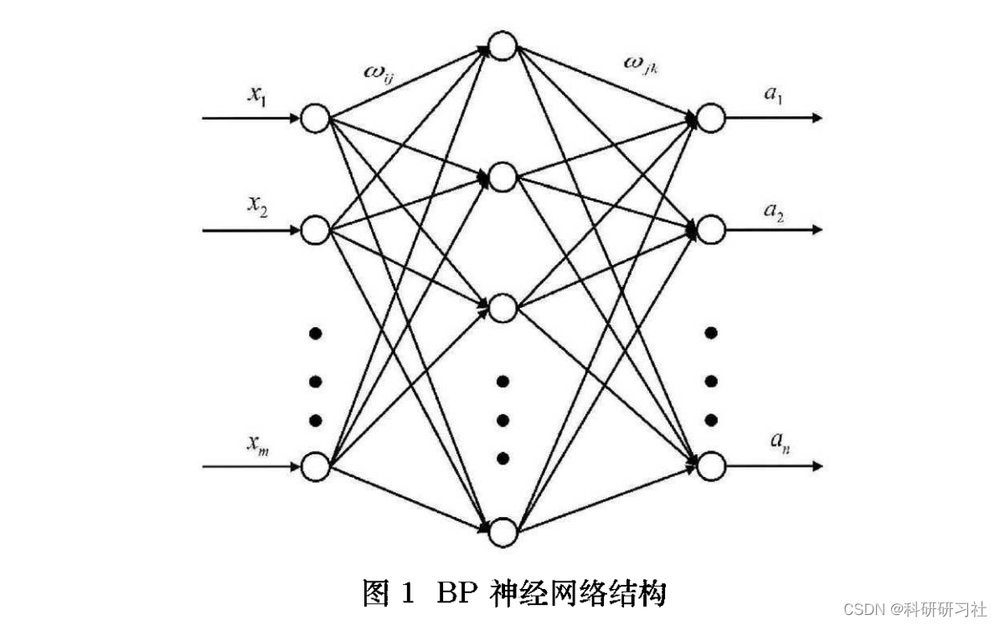
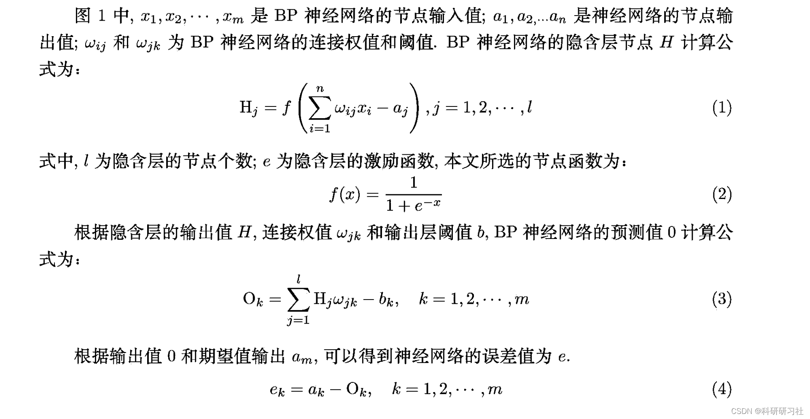
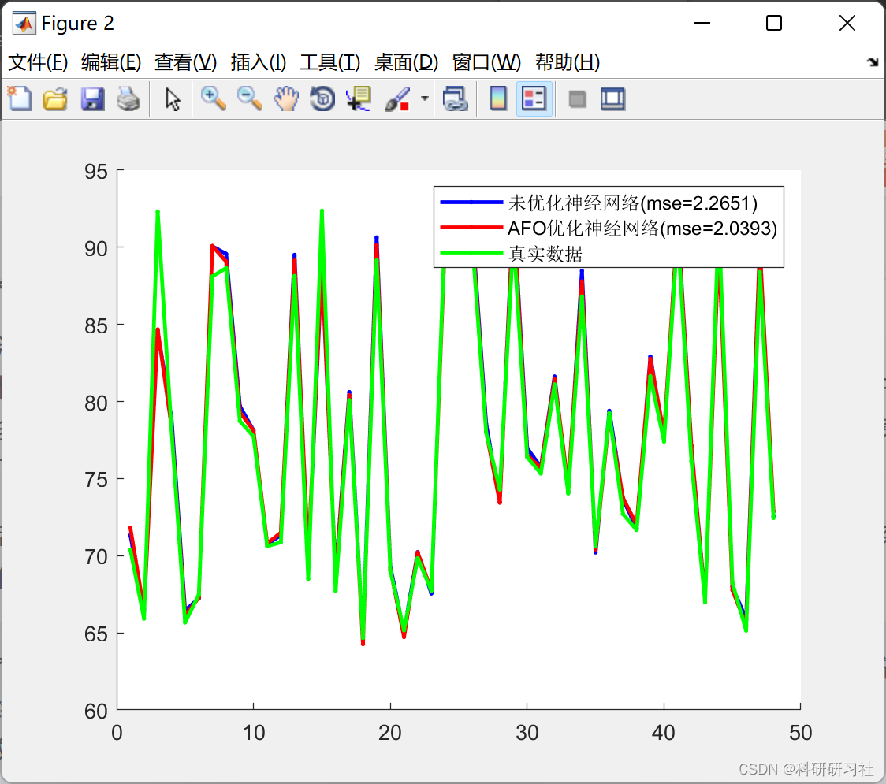
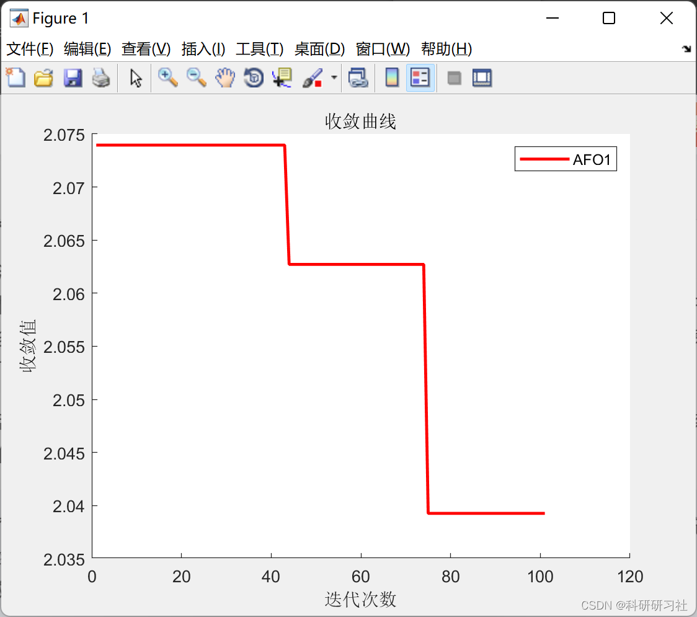
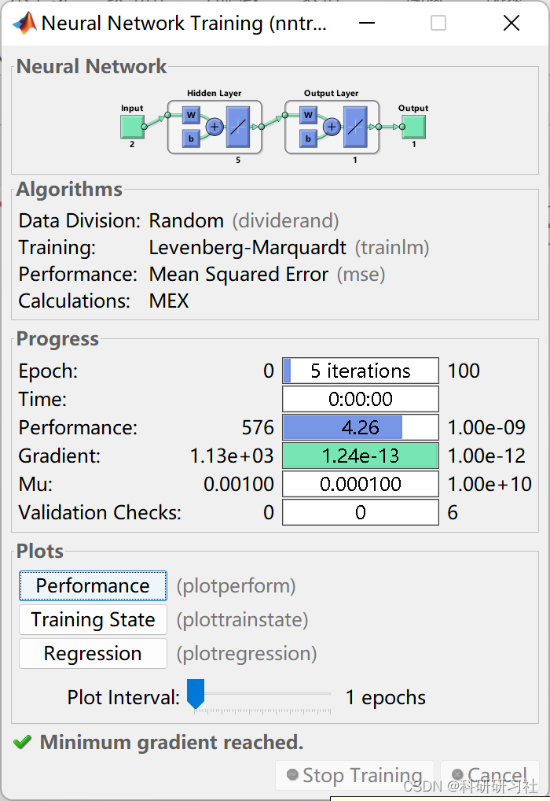

# Optimization of BP Neural Network for Data Prediction Based on Emperor Penguin Algorithm (Matlab Code)

1. BP Neural Network
A BP neural network is a type of feedback neural network characterized by its simple structure and fewer parameters to adjust, frequently used in pattern recognition, data compression, and prediction applications. The basic BP neural network consists of a three-layer network structure as shown in Figure 1.
The core idea behind the BP algorithm is to use gradient descent to search for the hypothesis space of possible weight vectors to find the optimal fit example weights. Specifically, it utilizes the loss function, moving towards the negative gradient direction of the loss function until the loss function reaches its minimum value.
Alternatively, the backpropagation algorithm determines the partial derivatives (gradients) of the loss function with respect to the weights and biases at each layer, also known as the gradients. These values are then used to update the initial weights and biases, continuing until the loss function reaches its minimum value or until the specified number of iterations is completed. This process helps to calculate the optimal parameters within the neural network.
Before formally introducing the BP algorithm, we need to understand the forward propagation process to determine the design of the network. For this purpose, we will set up a single-layer neural network as an example.
Editorial
Editorial
Detailed knowledge points explanation can be found in Part 4.
2. Emperor Penguin Optimization Algorithm (EPO)
The Emperor Penguin Optimization Algorithm (EPO), proposed by Gaurav et al., is a novel population-based optimization algorithm that simulates the behavior of penguins gathering together during winter for warmth. Baliarsingh et al. further applied EPO to solve multi-objective optimization problems. Kumar et al. used EPO for image segmentation problems. Jia et al. improved the Emperor Penguin Optimization Algorithm by combining polynomial mutation, Levy flight, and heat exchange operations strategies.
As mentioned above, the Emperor Penguin Optimization Algorithm has been applied to complex problems such as optimization engineering design, image segmentation, feature selection, and resource scheduling, demonstrating superior performance. Details on these topics can be found in Part 4.
This paper constructs a data prediction model based on the Emperor Penguin Algorithm optimized BP (AFO-BP) neural network. By using AFO to optimize the initial parameters of the traditional BP neural network, it helps to address the issues that the BP neural network tends to fall into local optima and is sensitive to the selection of initial connection weights and thresholds. 3 Run results editing
Editing
Editing
4 Matlab code and detailed reading of the article Only part of the code is shown in this paper; for all code and the article, please refer to:
%% Optimizing BP Neural Network for Data Prediction Based on Emperor Penguin Algorithm\nfunction [result]=myBP(option,data)\nhiddenumber=data.hiddenumber;\ninputnumber=data.inputnumber;\noutputnumber=data.outputnumber;\nS=data.S;\nindexM=data.indexM;\nN=data.N;\ninput_train=data.train_x0;\noutput_train=data.train_y0;\ninput_test=data.test_x0;\n% Creating a new bp neural network\nnet0=newff(input_train',output_train',hiddenumber);\n%net0.trainFcn='traingd';\nnet0.trainParam.epochs=50;%Number of trainings\nnet0.trainParam.lr=0.01;% Learning rate\nnet0.trainParam.goal=0.000001;\nnet0.trainParam.showWindow = false; % Do not display training window\nnet0.trainParam.showCommandLine = false;% The command line does not display the result\n[net0,tr]=train(net0,input_train',output_train');\nygabptest=sim(net0,input_test');\nygabptest=mapminmax('reverse',ygabptest,option.ps_y);%Prediction data denormalization\nT2=mapminmax('reverse',data.test_y0',option.ps_y);%Prediction data denormalization\nfit=sum(sum((ygabptest-T2).^2));\nresult.net=net0;\nresult.ygabptest=ygabptest';\nresult.T2=T2;\n\nygabptrain=sim(net0,input_train');\nygabptrain=mapminmax('reverse',ygabptrain,option.ps_y);%Prediction data denormalization\nT1=mapminmax('reverse',data.train_y0',option.ps_y);%Prediction data denormalization\nresult.ygabptrain=ygabptrain';\nresult.T1=T1;\nend\n  
5. References
[1] Li Xufei, Wang Zhen. Improved Emperor Penguin Optimization Algorithm for Solving Constraint Optimization Problems [J]. Computer Engineering and Design, 2021, 42(03): 703-710.
[2] Liu Yuan, Wang Fang. Short-term Wind Power Forecasting Using a Sparrow Search Algorithm Optimized BP Neural Network [J]. Shanghai Jiaotong University Journal, 2022, 25(03): 132-136.

## Images

<!-- PAYMENT_BLOCK -->

## Get this dataset

- Payment link (Stripe): [Buy now](https://buy.stripe.com/3cs8yP7sY87d0vu9AB)
- Payment QR code: 

<!-- /PAYMENT_BLOCK -->
